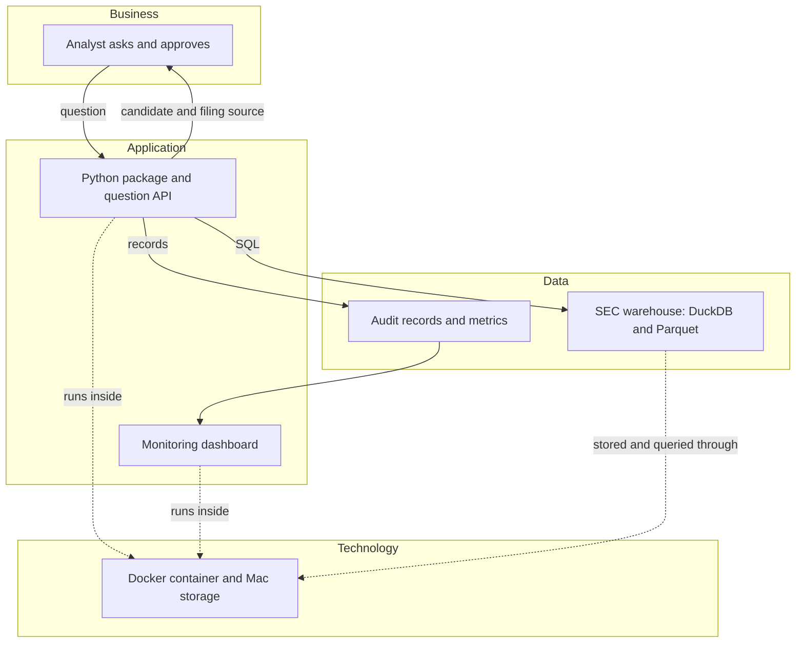

# RD1: architecture and human review

15 November 2026. Current local-demo design; draft reasoning for Nathan to review. No system changes or new tests.

## Four layers

| Layer | Simple meaning | Our project |
| --- | --- | --- |
| Business | Why, and who decides? | Help an analyst find a financial number. The analyst checks the filing and decides whether to use it. Nathan currently operates the demo. |
| Data | What information? | SEC files, prepared Parquet tables queried through DuckDB, concepts, evaluation answers and audit records. |
| Application | Which programs? | Python package, question API, notebook client and monitoring dashboard. |
| Technology | Where does it run? | Docker container on the Mac through Docker Desktop's Linux VM; local storage, two CPU quota and 3 GB limit. |

The dashboard is an application; its container is technology. Correctness needs reviewed answers in the data layer. Without those labels, a healthy dashboard cannot tell the business that a number is wrong.

## Our pattern and one alternative

We combine **batch preparation** of quarterly data, **online answering** when questions arrive, and **human review** before use. Batch preparation is not batch prediction. The API marks candidates for review; it does not automatically assign a reviewer or publish reports.

Both options below use the same model/container:

| Comparison | Current: review every question | Alternative: release returned numbers automatically |
| --- | --- | --- |
| Latency | Candidate p95 181.4 ms, within our provisional one-second budget. Human approval adds unmeasured time. | Same measured candidate speed; returned numbers can be used immediately. Unanswered questions still need an analyst. |
| Modelled daily workflow cost | EUR 700, assuming the full 20 analyst minutes per question. | EUR 892 at the observed held-out error rate; EUR 2,558 at its 95% error upper bound. |
| Decision owner | Analyst checks and approves each number. | Research manager owns the release policy; service releases available answers. |
| Failure handling | Check the original filing or answer manually. Human error remains possible. | Wrong numbers can reach reports before review. Refusal catches missing answers, not every wrong answer. Downtime needs a manual fallback. |

## Cost assumptions

Assume the notebook's 150 questions/week spread over five working days: 30/day. At 20 minutes and EUR 70/hour, analyst cost is EUR 23.33/question. Review-all costs 30 × EUR 23.33 = EUR 700/day; we have not measured whether assistance saves review time.

The automatic option uses the held-out results: 130/151 questions returned a number, two numbers were wrong, and 21 questions need an analyst. With EUR 2,000 assumed cost per wrong number, the recorded EUR 4,460.26/week becomes EUR 892.05/day. These are modelled costs, not observed losses, and assume analyst answers are correct.

Both options exclude shared electricity, hardware and maintenance costs, which are unmeasured. No paid model API or hosted service was used. Total IT cost/day is unknown; do not call the workflow estimate a measured hosting bill.

## Recommendation and switch condition

Keep human review. Speed is adequate for the demonstration, while the held-out wrong-number rate among returned answers is 2/130 (1.5%), with a 95% upper bound of 4.8%. FutureFuel even passes the notebook filter incorrectly.

Before considering selective automatic release, require the no-wrong-verified-answer gate to pass, an independently reviewed evaluation whose 95% upper wrong-number bound is below the task's 1% target, and p95 staying below one second under a justified workload. Current error evidence fails those conditions. This does not establish enterprise readiness or measured savings.

Sources: [measured service](../evidence/rd1-service-results.md), [policy assumptions/results](0002-preserve-notebook-referral-policy.md), supplied Session 1 knowledge notes. Implementation `7552b91`; technical evidence `b326794`. Daily figures divide weekly costs by five. Nathan should decide which reasoning he agrees with before using it in his reflection.
