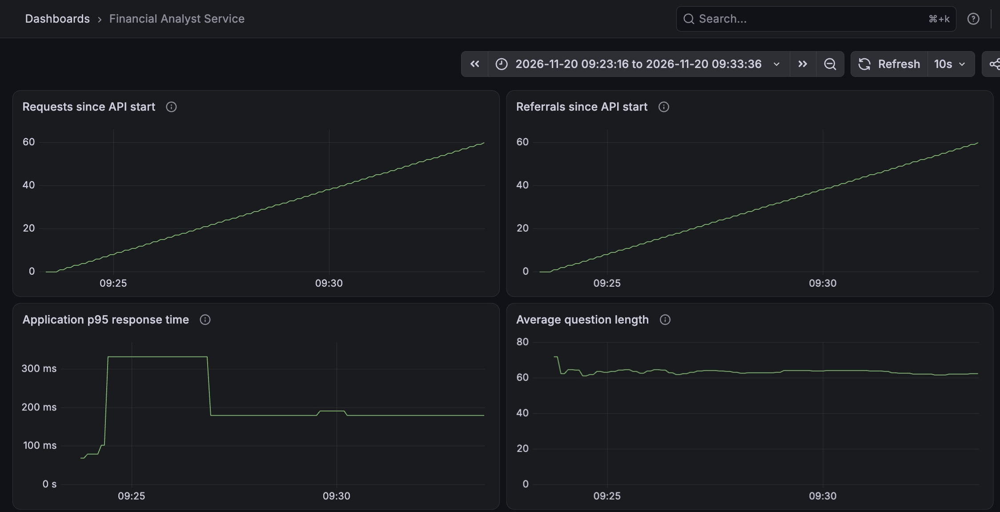

# Grafana monitoring runs

## Clean checkout used for the revised diary

The later test rebuilt the API from clean commit `4c9381e` in an isolated local Compose project. The API reported the same revision and the load client recorded a clean checkout. Sixty warm requests, ten seconds apart, gave 186.6 ms client p95 and 180.4 ms inside the API. All 60 cases went to review. There were 58 correct candidates, 62.3 characters per question on average and zero server or audit-write errors. With 60 timings the nearest-rank p95 is the fourth slowest. Image size was 1,203,940,594 bytes. The pinned requirements layer accounts for 762 MB according to Docker image history.

[Measured run and Grafana checks](rd1-clean-monitoring.json) · [60 requests](rd1-clean-monitoring-requests.csv) · [Dashboard screenshot](rd1-clean-grafana.png) · [Subsequent demonstration response](rd1-recorded-demo.json). The separate demo request was made after the fixed measurement window.

## Earlier working-copy run

On 20 November 2026, the API, Prometheus and Grafana ran together on Nathan’s Mac. The test sent 60 benchmark questions, one every ten seconds, to represent an assumed busy period with six analysts each asking once a minute. The service was already running when the test started. Startup and analyst review time are outside the timings.

| Measurement | Result |
| --- | --- |
| Requests and referrals | 60 requests, all referred |
| Candidate results | 58 correct, two missing rows |
| Errors | Zero client errors, HTTP server errors and audit write errors |
| Client p95 | 185.7 ms for the HTTP round trip |
| Final API p95 in Grafana | 180.4 ms across the 60 completed requests |
| Final mean question length | 62.3 characters |

Prometheus scraped the API every five seconds. Querying its history through Grafana returned 124 samples for the request and referral counters, which rose from zero to 60. The last samples for latency, question length and both error counters matched the API measurements. The chart shows p95 recalculated as responses arrive, so a slow early request can dominate while the sample is small.

This is a cropped screenshot of the Grafana dashboard over the recorded run. The [run record](rd1-grafana-run.json) contains the fixed time range, final measurements, time series checks and image details. The [per-request results](rd1-grafana-requests.csv) contain the client timings.

The API image was built from the monitoring changes on top of `3c9c043` before committing. Its source fingerprint and image ID identify the tested copy. The measured API image size was 1,203,941,285 bytes. The earlier [RD1 baseline results](rd1-service-results.md) record the separate run used for the fresh-copy comparison and the original dashboard screenshot.

See the [monitoring guide](../monitoring.md#prometheus-and-grafana) to start the stack and repeat the test.
