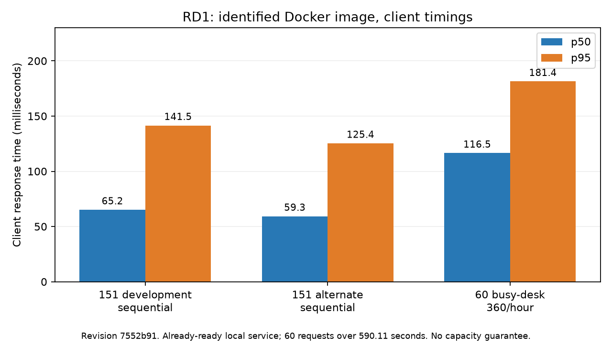
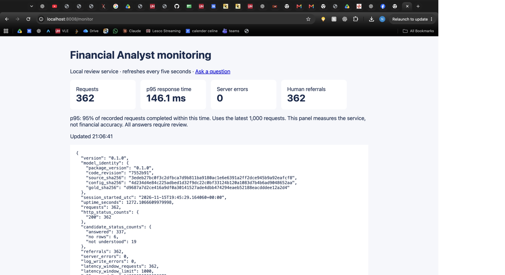

# RD1 service results — final technical evidence

Measured 15 November 2026. Technical implementation: **`7552b91`**. This is the current table to use in RD1; earlier reports/figures describe historical runs.

## Consolidated service table

| Item | Measured result | Evidence / limits |
| --- | --- | --- |
| Given mapper, company-held-out | Top-1 32.5%; top-5 60.5% (95% interval 56.8%–64.2%); 702 tags | Fresh local clone, same given method |
| Given mapper fitting/build time | 6.32 seconds; scoring 1.18 seconds | Current fresh-clone run; build includes vocabulary/vector/index construction, not raw conversion |
| Final answer metric | Development 147/151 (97.4%; interval 93.4%–99.3%); alternate wording 128/151 (84.8%) | Candidates; all actual serving decisions remain human referral |
| Fresh-copy result | Ten tests pass; 27,677 filings, 7,229 companies, 10,890,076 facts; final answer/mapper metrics reproduced | Exact saved commit, no-cache Linux build, empty generated-output folder, runtime network disabled |
| Serving image size | 1,203,903,312 bytes (1.20 GB decimal / 1.12 GiB) | Linux ARM64, one worker, two CPU quota, 3 GB limit |
| Training/serving consistency | All 302 candidate values/statuses/correctness flags match corresponding offline evaluation | All 151 questions in each of two phrasings |
| Development sequential sweep | 151 requests; client p50 65.2 ms; p95 141.5 ms; maximum 254.7 ms | HTTP 200 for all; no client errors; 147 correct candidates; 151 referrals |
| Alternate-wording sequential sweep | 151 requests; client p50 59.3 ms; p95 125.4 ms; maximum 243.0 ms | HTTP 200 for all; no client errors; 128 correct candidates; 151 referrals |
| Declared busy-desk workload | 60 requests; client p50 116.5 ms; p95 181.4 ms; maximum 364.4 ms | HTTP 200 for all; no client errors; 58 correct candidates; 60 referrals |
| Audit integrity | 362 unique request IDs match saved candidate values/statuses/identity/review decisions | Zero server or log-write errors |
| Input monitoring | Question length measured; all six question families represented in the paced scenario | Dashboard also shows status mix and references the tested revision |

## Dashboard panel

This is an actual Chrome screenshot of the service, not a recreated chart. It shows 362 requests and 362 referrals: 151 development + 151 alternate-wording + 60 paced requests. The mixed-window application p95 is 146.1 ms. The client p95 for only the 60-request workload is 181.4 ms. They measure different scopes; do not substitute one for the other. The application timer stops before its audit append; the client includes that delay and response delivery.

## Workload justification and limits

The declared busy-period scenario is six analysts each asking one question per minute, represented by 60 scheduled arrivals ten seconds apart at 360/hour. This is a design assumption for a short analyst-desk peak, not observed organizational traffic or an average all-day demand forecast. The 60 requests completed over 590.11 seconds. They cover 18 point, 15 fiscal, nine count, six sum, six rank and six quarter questions. Maximum scheduling delay was 24.5 ms. There was no restart during any experiment.

The service was already initialized and data caches were warm; startup and cold-cache latency are excluded. Client and Docker Desktop shared Nathan's Mac, with ordinary background applications running. Constant staggered arrivals are not a simultaneous-user burst or a prolonged capacity test. With 60 observations nearest-rank p95 is the fourth-largest; substantial sampling uncertainty remains. The provisional one-second interactive demonstration target was met in this run; it is not an agreed production SLO. The earlier 150/hour ten-request sample is separate; economic policy uses 150/week.

The 60-request sample returned 58 correct candidates and two no-row outcomes. HTTP success therefore does not mean every question received a number. All candidates, including wrong baseline answers in the full sweeps, are referred. No LLM or paid external API participates.

## Forward-time and data evidence

See [data quirks](data-quirks.md) for remeasured counts, consequences and protecting tests, and [forward-quarter evaluation](forward-time.md) for the original and time-restricted diagnostics. Q1 frozen/refreshed scores are not a future holdout; Q2–Q4 are the forward tests. Retrospective silver labels and full-year vocabulary exposure in the original diagnostic are disclosed. The strict input check restricts vocabulary/metadata by cutoff without changing the learner.

## Current fresh-copy reproduction

Fresh local clone of `7552b918940c68d06ccf6d6d3d8e4c95a5cbc9f1` produced image `sha256:8f32616c01bdb0e2680d0732265c43a55c96d3b7f9d384979a1fd3bee46c5bee` (1,203,904,993 bytes). This is a separate image from the serving image, as no-cache build artifacts can differ. Counts, final metrics and all six referral-policy summaries reproduced. All R2–R4 individual values/statuses/correctness match the main evaluation, and all 151 alternate phrasings match.

Fresh R0 is 39.1% and R1 68.2%, compared with main-file R0 38.4% and R1 69.5%. R0 has two differing values/one correctness flag and R1 twelve differing values/ten flags. Early templates retain the previously investigated order/tie sensitivity. The final model and given algorithm were not tuned to hide those differences. This is a declared final-baseline reproduction, not bitwise-identical reproduction of every early rung.

## Traceability

Serving image: `sha256:0da6b54749409860753da57bdefa4bab150044d51a1ea9714546327058d52fd6`; full source commit `7552b918940c68d06ccf6d6d3d8e4c95a5cbc9f1`. Golden fingerprint `d9687a7d2ce416a9df0a30141527ade4dbb474294eaeb52188eacdddee12a2d4`.

Machine-readable experiment setup/server identities/results: [rd1-experiment-manifest.json](rd1-experiment-manifest.json). Compact per-request CSVs: `rd1-client-development.csv`, `rd1-client-held-out.csv`, `rd1-client-rd1-peak.csv`. Audit reconciliation: `rd1-audit-reconciliation.json`. Raw input hashes/stage timings: `rd1-reproduction-manifest.json`; comparison: `rd1-reproduction-comparison.json`. Thin notebook execution: `rd1-notebook-check.json` (four code cells; not a Jupyter UI test).

Bulk raw/prepared data, full generated logs and working artifacts remain ignored under `data/`. Selected compact evidence is intentionally versioned. Audit model identity describes source/configuration/golden version; raw-data fingerprints are recorded separately in the reproduction manifest. No claim of an MLflow-registered model artifact is made.

## What remains outside this technical checkpoint

Later work added the [architecture comparison](../decisions/0008-architecture-and-review.md), [AI Act assessment](../decisions/0009-ai-act-classification.md) and [written preview](../../output/pdf/RD1-written-entry-preview.pdf). Nathan still needs to review the reflection and finish the submission. Full final-project raw contracts, independent convention suite, automated release gate, MLflow, graph/knowledge-layer extensions and LLM work are not completed by this checkpoint. The wrong verified FutureFuel answer still blocks automatic release.

## Notebook-prose differences we do not hide

The task notebook's summary names mapper top-1 32.3%, golden hash prefix `0c4d749d61487864…`, and verified-policy EUR 2,589/week. Nathan's recorded notebook execution and our packaged runs give 32.5%, fixed hash `d9687a7d2ce416a9…`, and EUR 2,566/week on development wording. These prose figures have not all been reproduced exactly. Top-5 60.5%, R4 147/151 and alternate wording 128/151 do reproduce. ADR 0001 records the benchmark/order investigation; the earlier source-on-same-input compatibility checks support preserving the algorithm rather than tuning to the prose. Unknown original build/data-order/dependency details remain a limitation. Do not silently substitute an unpublished expected value, change the model, or describe all prose targets as exact matches.

Acceptance for this investigation is explicit: dataset counts, fixed observed golden fingerprint, final answer counts and later-rule per-question comparisons must match exactly; mapper top-5 is compared at the notebook's displayed 0.1-percentage-point precision. The top-1 prose discrepancy is reported, not declared an exact pass. Full published-hash reconstruction remains an open provenance question for the larger project.
