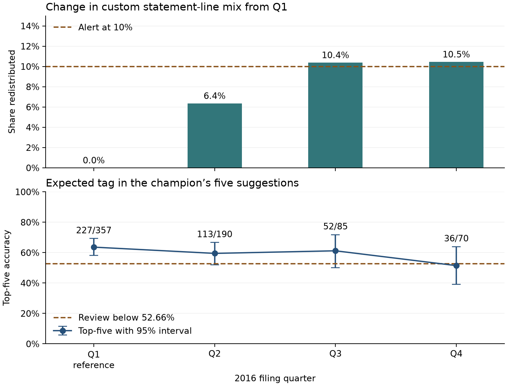

# RD2 Task 5 — Did a changing input mix affect the mapper?

The March champion ranks standard accounting tags for a company's own tag. It uses the statement type to decide which tags are eligible. We measured how often custom lines appeared on balance sheets, cash-flow, comprehensive-income, equity and income statements. Each filing/tag contributes once, using the earliest eligible statement line, as in the mapper preparation. We compared each quarter's distribution with Q1.



| 2016 quarter | Custom lines monitored | Mix shift from Q1 | Correct in top five | Accuracy (95% interval) | Policy outcome |
|---|---:|---:|---:|---:|---|
| Q1, reference | 67,004 | 0.00% | 227/357 | 63.59% (58.15–69.23%) | Reference only |
| Q2 | 58,446 | 6.36% | 113/190 | 59.47% (51.87–66.67%) | Routine monitoring |
| Q3 | 51,099 | 10.38% | 52/85 | 61.18% (50.00–71.79%) | Input review |
| Q4 | 53,057 | 10.45% | 36/70 | 51.43% (39.13–63.89%) | Input and accuracy review |

**What the two measurements tell us.** Drift uses every eligible custom filing line. Accuracy uses only held-out company tags with an expected answer inferred from later filings. Q1 supplies the reference mix and a same-quarter diagnostic. Only Q2–Q4 belong to the frozen forward test, totalling 201/345. Each interval resamples whole companies within that quarter 10,000 times, using seed 3217. The smaller Q4 sample gives a wide interval.

Q3 and Q4 had almost identical drift, yet their accuracies differed by nearly ten percentage points. Equity-statement lines accounted for 26.0% of custom lines in Q1 and about 15.7% in Q3 and Q4. These observations support an input alert in both quarters, but cannot attribute Q4's errors to the change in mix. A monitor watching only that mix would miss the fall between Q3 and Q4. It would also miss wrong recommendations within a stable mix.

**Other signals to inspect.** Q2 added 904 previously unseen filers and 15,065 custom tag names. Q3 added 172 and 6,918. Q4 added 142 and 6,133. Among standard US-GAAP numeric facts, the share using the 2016 taxonomy rose from 0.30% in Q1 to 22.95%, 64.29% and 80.08%. These describe the filings. They do not establish that the new taxonomy caused a bad suggestion.

**Decision.** Alert at 10% input drift or below 52.66% accuracy. Train a candidate after two consecutive quarters below the accuracy floor. Only Q4 was below it, so March stays champion. Nathan owns any alias change. [Full policy and trade-offs](../../decisions/0015-quarterly-mapper-monitoring.md)

## Evidence and tests

| Record | Identifier or outcome |
|---|---|
| Measured code | Git commit `4865f8f` |
| Registered mapper | `sec-standard-tag-mapper` version 2, training run `433508d40ff64b7a9beff45d995f7f96` |
| Monitoring / repeat | `d9a07fee6403432081c3fbb09125b8b0` / `74efc7048ad943cd9e9c261a0bb717b8` |
| Full local CI | `01f91835e23c4738a0fb9e084af9c738`. Lint, all 14 unit tests, data validation and the release gate passed. |
| Independent checks | Counted each statement category directly from the submission and presentation Parquet files. All counts matched. Forward hits and denominators matched the saved March rankings in every quarter. |
| Repeatability | Both monitoring runs produced byte-identical quarterly tables, taxonomy and statement counts, and figure. Checked the registry after replay. Champion was still version 2. |

The MLflow runs store the input, training and holdout fingerprints, model version, quarterly metric history, exact per-case ranks, figure and count tables. The primary monitoring run also holds the CI transcript and verification summary. Two targeted tests cover category changes, exact alert boundaries, missing labels, consecutive low quarters and recovery. [Manifest](monitoring/manifest.json) · [Quarterly results](monitoring/quarterly.csv) · [Statement counts](monitoring/statement-counts.csv) · [Taxonomy counts](monitoring/taxonomy-counts.csv)

## Reproduce

From the project root with the RD2 dependencies, prepared quarters and the Task 4 registry, run the following. The first command uses the locally registered champion and records a new MLflow run. The second runs the full repository checks.

```bash
python -m sec_analyst.rd2_monitoring
make ci
```

The default figure and tables go under `data/monitoring/rd2/`. Use `--output data/monitoring/replay` to keep a second copy. On a fresh checkout, reproduce the [Task 4 registry](task-4.md#reproduce-locally) first.
