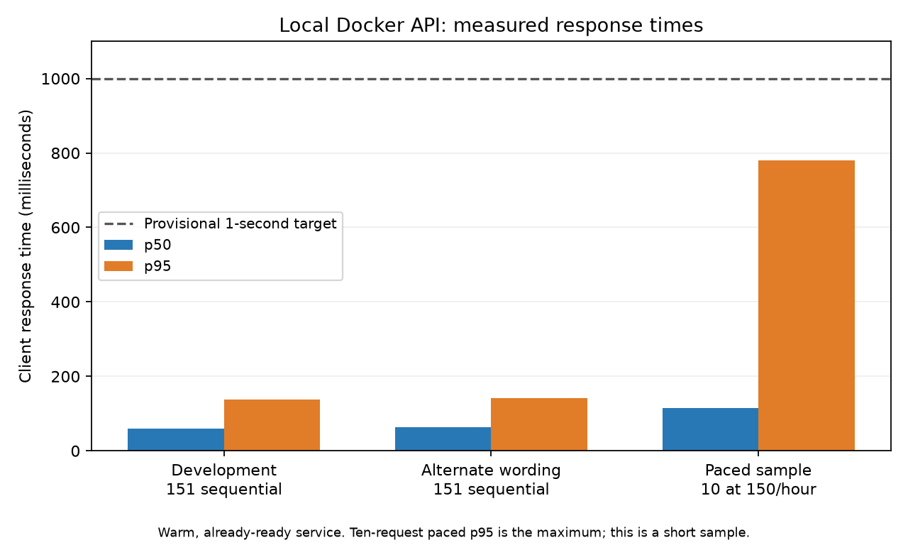

# Served answers and performance — 15 November 2026

Measured against base commit `ee3bfe5` with uncommitted monitoring changes. Image `fin-analyst:rd1`, ID `sha256:c00800033fb446e87cdef956e403b2bfeef22547a41903c422d0b8867857cecb`, inspected size 1,203,711,808 bytes. Linux ARM64; one Uvicorn worker, two CPU quota, 3 GB limit; same Mac hosts client and Docker Desktop. Already-ready/warm service.

Golden SHA-256: `d9687a7d2ce416a9df0a30141527ade4dbb474294eaeb52188eacdddee12a2d4`.

| Experiment | Requests | Correct candidates | HTTP failures | Client p50 | Client p95 | Slowest |
| --- | ---: | ---: | ---: | ---: | ---: | ---: |
| Development wording, sequential | 151 | 147 | 0 | 59.2 ms | 137.0 ms | 252.2 ms |
| Alternate wording, sequential | 151 | 128 | 0 | 62.9 ms | 141.0 ms | 273.3 ms |

All 302 candidate values, candidate statuses and correctness flags exactly match the corresponding offline evaluation records, including existing wrong and unanswered cases. All 302 HTTP responses were 200 and all decisions were referral. Candidate correctness remains 147/151 development and 128/151 alternate wording. This demonstrates full fixed-set serving consistency for these two phrasings; it does not fix the underlying errors.

The sequential sweeps took 10.20 and 9.99 seconds respectively. Their throughput is a short warm sequential burst observation, not a sustainable capacity claim. The dashboard mixes requests across experiments; use the separate client summaries for this table.

The paced run completed; its results are below. Detailed per-request records are saved under ignored `data/evaluation/api_development/`, `api_held-out/` and `api_paced/`. The script and this compact evidence report are intended for Git; full evaluation artifacts stay outside Git.

The image predates these final experiment documentation/script edits. Before submission, commit the implementation, rebuild and repeat the chosen experiment against that exact commit/image. A provisional p95 target of one second is met in these short functional sweeps; no claim about production suitability follows.

## Correctness by question family through HTTP

| Family | Development correct | Alternate wording correct |
| --- | ---: | ---: |
| count | 12/12 | 12/12 |
| fiscal | 38/40 | 19/40 |
| point | 48/48 | 48/48 |
| quarter | 25/27 | 25/27 |
| rank | 12/12 | 12/12 |
| sum | 12/12 | 12/12 |

Development: two wrong numbers and two unanswered; alternate wording: two wrong numbers and 21 unanswered (19 not understood, two no rows). The same parser/model limitations remain observable through the API.

## Short paced sample at 150 questions/hour

Ten scheduled arrivals 24 seconds apart completed over 216.08 seconds, covering all six families. All ten returned HTTP 200, all candidates matched their references, and all decisions were human referral. Client p50 was 115.4 ms, p95/maximum 779.6 ms. Maximum dispatch delay was 19.9 ms. No client connection failures occurred.

With only ten observations, nearest-rank p95 equals the maximum. This sample does not establish sustained capacity or a stable tail-latency estimate. It met the provisional one-second demonstration budget on this run. The apparently slower paced p95 versus the burst is a measured difference under different cache/idle/workload conditions; the experiment does not establish its cause. Do not conclude that increasing traffic makes the service faster.

The measured API image was the ID stated above. A subsequent packaging rebuild adds the client script/tests; it does not change the API implementation. Rebuild/repeat against a reviewed commit before final submission.

All ten tests passed locally and in the subsequent packaging rebuild, whose image ID is `sha256:cd1fed4661d716e8494c15d810f1e4c80917f6b86a794049b74019446b48e611`. Compose reported healthy after that restart. The timing table measures the earlier image identified at the top, not this subsequent rebuild.
