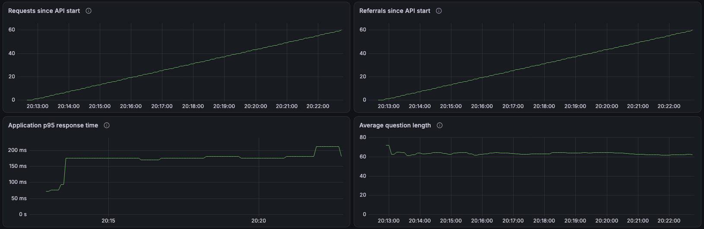

# From notebook to monitored service

Working copy for Nathan’s final review. 534 counted words including headings, classification and disclosure. [Word](../../output/RD1-entry-1.docx) · [PDF](../../output/pdf/RD1-entry-1.pdf).

Nathan Vella   ·   Financial Statement Analyst   ·   Sessions 01 to 04

## Starting with the filings

Companies use different labels for the same idea. The notebook matches those labels to standard tags and looks up a figure for the company and period. I wanted to know when an analyst could trust it.

I moved the supplied method into a Python package. Four notebook cells call it, a settings file selects the quarters and one training command builds the tag index. I checked the original answers before serving them.

### What I found in the data

Reordering identical rows changed ten questions. That surprised me. The sampler picks positions, so a fixed seed can select different companies. I saved the original 151 questions and checked their fingerprint before scoring. I could then compare runs question by question.

| What the card says | What I found | Consequence for the model | My test or check |
| --- | --- | --- | --- |
| “Duplicates by design” includes several durations at one date. | 11,365 of 17,312 quarterly filings with main-company net income at period end had several durations. There were 19,223 quarterly filings overall. | 5,647 filings had different three- and six-month USD values available. Either could be picked if the duration rule is lost. | My test puts both durations in one filing. Only the one-quarter amount can pass. |
| “Units and scale” includes currencies other than US dollars. | Of 20,342 four-quarter revenue or net-sales facts, 137 used CNY and 61 used JPY. | Adding currencies at face value made the annual Revenues sum 8.8 times the USD-only sum. | My test places JPY 999 beside USD 100 and requires USD 100. |
| “Fiscal is not calendar.” | 467 of 6,382 annual reports had a fiscal year different from the calendar year of the end date. | A calendar filter misses a report ending March 2016 when asked for fiscal 2015. | The fiscal-year query must find that report and exclude its amendment. |
| Extra finding beyond the card | Reordering 51,356 rows changed 10 of 24 sampled net-income questions in the 151-question benchmark. | Two scores can represent different questions. | The saved benchmark must match its recorded fingerprint. |

Sources  ·  Data and tests at 7552b91. Counts, original notebook fingerprint and timing in rd1-review-calculations.json at cdce639.

## Rebuilding and timing the service

Docker exposed an assumption in my Mac setup. The clean image installed the package with build isolation disabled, so it needed setuptools in that environment. My local setup already worked. Pinning setuptools fixed the failed installation.

| Measure | Notebook or earlier baseline | Package or clean run | Commit¹ |
| --- | --- | --- | --- |
| Headline metric: correct final answers | Original wording 147/151 (97.4%). Reworded 128/151 (84.8%). | Fresh clone matched both. Live and offline checks agreed on all 302 cases. | b326794 |
| Mapper training and accuracy | Original notebook code, timed again on the prepared data: 4.47 s to build. Top five 60.5% on 702 tags. | 6.32 s to build, 1.18 s to score. Same top-five accuracy and company split. | b326794 / cdce639 |
| Reproduction limits | Early queries could choose between tied rows. | 10 tests passed. R2–R4 values matched exactly. R0 changed 2 values and R1 changed 12. | b326794 |
| Forward check | Q1 vocabulary and index frozen. Test tags in Q2/Q3/Q4: 190/85/70. | Top five: 59.5%, 61.2%, 51.4%. Overlapping intervals and only 70 Q4 tags limit evidence of a decline. Later filings helped label and select test cases, giving hindsight. | b326794 |
| Container and p95 | Prior paced baseline: 181.4 ms at the client. | Clean API image 1.204 GB, including a 762 MB requirements layer. Client p95 186.6 ms. | 4c9381e² |
| 60 warm requests | 0.1 requests/s for roughly ten minutes. | 60 sent to analyst review, 58 correct candidates. Average input length 62.3 characters. | 4c9381e |

I simulated six analysts asking once a minute. At this low load, the fourth slowest of 60 requests sets p95. Each prediction logs the model version. Prometheus collects measurements every five seconds, and Grafana shows response time and question length.

Figure 1. Inside the API, p95 was 180.4 ms. The client time includes the round trip. A referral means an analyst must check the result before use.

Sources  ·  ¹ Git evidence or tested revision. Baseline evidence b326794 records tested code 7552b91. ² Earlier timing at b326794. Clean run, image ID and request CSV archived at cdce639.

## Where the analyst fits

Figure 2. Quarterly filings feed DuckDB. The Python package proposes a figure online. The analyst checks its source and decides whether to use it.

### Two ways to use the service

| Decision | Review every question | Release every available figure |
| --- | --- | --- |
| Time budget | Candidate p95 186.6 ms. Target under 1 s. Review adds unmeasured time. | Same engine and one-second budget. The figure reaches the desk immediately. |
| Daily cost | €700 = 30 × €23⅓ per review. | €892 at the observed error rate. €2,558 at its upper confidence bound. |
| Decision owner | An analyst approves each figure. | The research manager owns the release rule. |
| Failure | Check the filing or answer manually. | Missing answers go to review. A wrong figure can reach a report. |
| Cost calculation | 30 questions/day, 20 min at €70/hour per review. Both estimates exclude shared IT costs. | 30 × [(2/151 × €2,000) + (21/151 × €23⅓)] = €892. For €2,558, replace 2/151 with (130/151 × 0.0476352), using the exact one-sided 95% upper error bound for 2 wrong in 130. |

### EU AI Act classification

Minimal risk for company lookup (Arts 5–6)  |  Provider: Nathan, Art. 3(3)  |  Deployer: research firm, Art. 3(4)

This assumes I supply the AI service under my name. Annex III 5(b) covers personal creditworthiness. Company lookup falls outside that use. Article 50(1) can still require telling analysts they are interacting with AI unless that is obvious.

Sources · EU AI Act · [Article 3](https://ai-act-service-desk.ec.europa.eu/en/ai-act/article-3) · [5](https://ai-act-service-desk.ec.europa.eu/en/ai-act/article-5) · [6](https://ai-act-service-desk.ec.europa.eu/en/ai-act/article-6) · [Annex III](https://ai-act-service-desk.ec.europa.eu/en/ai-act/annex-3) · [25](https://ai-act-service-desk.ec.europa.eu/en/ai-act/article-25) · [50](https://ai-act-service-desk.ec.europa.eu/en/ai-act/article-50)

## Why I kept human review

A wrong figure passing verification also surprised me. For FutureFuel’s sales, the service returned $69,306,000 for goods sold. The reference used $66,893,000, excluding related-party sales. Repeating the query confirmed the number on the selected line. It took a person reading the filing to spot why that line answered a different question.

Grafana showed how quickly the service answered. To check accuracy I needed the reference answers. Of 151 reworded questions, 21 returned no number, 130 returned a number, and two of those were wrong. That left 128 correct.

Under the cost assumptions above, automatic release costs about €192 more each working day. The assumed cost of a mistake matters. At the observed error rate, the options break even at €1,517 per wrong release. Below that, automatic release is cheaper. The desk would still have to meet its accuracy target.

Before trying selective release, I would ask an independent financial analyst to check 300 distinct, representative verified figures against their filings. With zero errors, the exact one-sided upper 95% confidence bound is 0.99%. This allows for sample size and falls below the desk’s 1% limit. I would also time the analysts, check selective release costs less than €700 per day, and retain the one-second budget already met.

If a lender repurposes the deployed system to assess an individual’s creditworthiness and the system becomes high-risk, Article 25(1)(c) can make that lender the provider.

I used OpenAI Codex for code, evidence checks and drafting. I take responsibility for the reasoning and decisions in this entry.

Sources  ·  Cost model and sensitivity in rd1-review-calculations.json at cdce639. FutureFuel comparison in ADR 0002. Classification assumes a future research-desk deployment.
